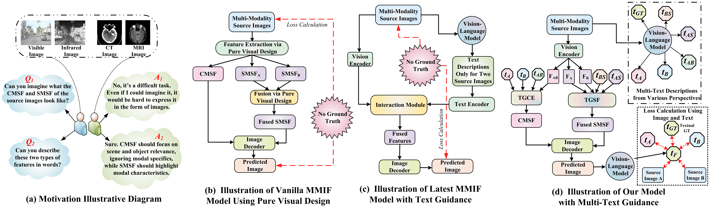
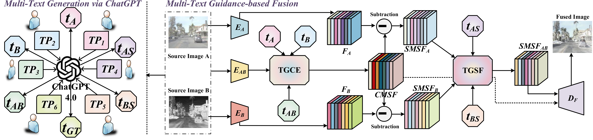

<h1 align="center">MTG-Fusion</h1>

<h3 align="center">Multi-Text Guidance Is Important: Multi-Modality Image Fusion via Large Generative Vision-Language Model</h3>

<p align="center">
  Zeyu Wang · Libo Zhao · Jizheng Zhang · Rui Song · Haiyu Song · Jiana Meng · Shidong Wang
</p>

<p align="center">
  <a href="https://doi.org/10.1007/s11263-025-02409-3"><strong>Paper</strong></a>
  &nbsp;&nbsp;•&nbsp;&nbsp;
  <a href="#framework"><strong>Framework</strong></a>
  &nbsp;&nbsp;•&nbsp;&nbsp;
  <a href="#requirements"><strong>Requirements</strong></a>
  &nbsp;&nbsp;•&nbsp;&nbsp;
  <a href="#training"><strong>Training</strong></a>
  &nbsp;&nbsp;•&nbsp;&nbsp;
  <a href="#inference"><strong>Inference</strong></a>
  &nbsp;&nbsp;•&nbsp;&nbsp;
  <a href="#citation"><strong>Citation</strong></a>
</p>

## Overview

MTG-Fusion is a multi-text guided framework for visible-infrared and medical image fusion. It uses a text-guided cross-modality shared feature extractor and a text-guided single-modality specific feature fusion module to integrate complementary visual information under multi-text guidance.

<p align="center">
  
</p>

## Framework

<p align="center">
  
</p>
<p align="center"><em>Overall framework of MTG-Fusion.</em></p>

## Requirements

```bash
conda create -n mtg python=3.10 -y
conda activate mtg
pip install -r requirements.txt
```

## Data Preparation

Please refer to [Quick Test with Our Prepared Data](#quick-test-with-our-prepared-data) for the released datasets and to [Test on Your Own Data](#test-on-your-own-data) for preparing custom image pairs, manifests, descriptions, and text caches.

## Training

MTG-Fusion is trained in two stages. The following commands use MSRS as an example.

### Stage 1: Visual Fusion Training

```bash
python train.py \
  --config configs/vis_ir.yaml \
  --stage 1 \
  --manifest data/msrs_train.jsonl \
  --output runs/msrs_stage1
```

### Stage 2: Text-Guided Training

```bash
python train.py \
  --config configs/vis_ir.yaml \
  --stage 2 \
  --manifest data/msrs_stage2_383_text.jsonl \
  --text-cache data/msrs_stage2_383_text.pt \
  --val-manifest data/msrs_val_text.jsonl \
  --val-text-cache data/msrs_val_text.pt \
  --resume runs/msrs_stage1/best.pt \
  --output runs/msrs_stage2
```

Stage 2 must be initialized from the converged Stage 1 checkpoint. Replace the dataset prefix and configuration file when training on another dataset.

## Inference

### Quick Test with Our Prepared Data

> The pretrained checkpoints are under `checkpoints/`, and the prepared test manifests, text descriptions, and text caches are under `data/`. The source images are not included because of their file sizes; therefore, `datasets/` is empty by default.

#### Download the Datasets

Download our prepared training and test splits:

<p align="center">
  <a href="https://pan.baidu.com/s/1TUk6dKbdgTJcDMZ2keTSrg?pwd=7nmd"><strong>Download the prepared datasets</strong></a>
</p>

Extract the downloaded package into the repository root. The expected structure is:

```text
datasets/
├── MSRS/
│   ├── train/{ir,vi}
│   └── test/{ir,vi}
├── RoadScene/
│   ├── train/{ir,vi}
│   └── test/{ir,vi}
├── M3FD/
│   ├── train/{Ir,Vis}
│   └── test/{Ir,Vis}
├── CT-MRI/
│   ├── train/{CT,MRI}
│   └── test/{CT,MRI}
├── PET-MRI/
│   ├── train/{PET,MRI}
│   └── test/{PET,MRI}
└── SPECT-MRI/
    ├── train/{SPECT,MRI}
    └── test/{SPECT,MRI}
```

The pretrained checkpoints are organized as:

```text
checkpoints/
├── msrs.pt
├── roadscene.pt
├── m3fd.pt
├── ct_mri.pt
├── pet_mri.pt
└── spect_mri.pt
```

> [!IMPORTANT]
> Folder names are case-sensitive and should not be changed because the prepared manifests use relative paths rooted at `datasets/`.

#### Run Inference

For example, test MTG-Fusion on MSRS:

```bash
python infer.py \
  --config configs/vis_ir.yaml \
  --checkpoint checkpoints/msrs.pt \
  --manifest data/msrs_test_text.jsonl \
  --text-cache data/msrs_test_text.pt \
  --output results/MSRS \
  --restore-color
```

Use the corresponding files for the other datasets:

| Dataset   | Config                | Checkpoint                 | Test Manifest                    | Text Cache                    |
| :-------: | :-------------------: | :------------------------: | :------------------------------: | :---------------------------: |
| MSRS      | `configs/vis_ir.yaml` | `checkpoints/msrs.pt`      | `data/msrs_test_text.jsonl`      | `data/msrs_test_text.pt`      |
| RoadScene | `configs/vis_ir.yaml` | `checkpoints/roadscene.pt` | `data/roadscene_test_text.jsonl` | `data/roadscene_test_text.pt` |
| M3FD      | `configs/vis_ir.yaml` | `checkpoints/m3fd.pt`      | `data/m3fd_test_text.jsonl`      | `data/m3fd_test_text.pt`      |
| CT-MRI    | `configs/mif.yaml`    | `checkpoints/ct_mri.pt`    | `data/ct_mri_test_text.jsonl`    | `data/ct_mri_test_text.pt`    |
| PET-MRI   | `configs/mif.yaml`    | `checkpoints/pet_mri.pt`   | `data/pet_mri_test_text.jsonl`   | `data/pet_mri_test_text.pt`   |
| SPECT-MRI | `configs/mif.yaml`    | `checkpoints/spect_mri.pt` | `data/spect_mri_test_text.jsonl` | `data/spect_mri_test_text.pt` |

Use `--restore-color` for MSRS, RoadScene, M3FD, PET-MRI, and SPECT-MRI. It can be omitted for grayscale CT-MRI fusion.

---

### Test on Your Own Data

> To test your own data, organize the image pairs, build a manifest, generate descriptions, cache the text embeddings, and run inference. We generated our prepared descriptions using the ChatGPT-4.0 API. For your convenience, a local Qwen model is recommended without API credentials.

#### 1. Organize the Image Pairs

```text
datasets/custom/
├── source_a/
│   ├── 00001.png
│   └── ...
└── source_b/
    ├── 00001.png
    └── ...
```

#### 2. Build the Manifest

```bash
python tools/build_manifest.py \
  --ir-dir datasets/custom/source_a \
  --vis-dir datasets/custom/source_b \
  --color-source b \
  --output data/custom_test.jsonl
```

Here, `--ir-dir` and `--vis-dir` represent source A and source B. Use color source `b` for infrared–visible fusion and `a` for PET–MRI or SPECT–MRI. Add `--recursive` for nested directories.

#### 3. Generate and Cache Text

**Generate descriptions**

```bash
python tools/generate_descriptions.py \
  --input data/custom_test.jsonl \
  --output data/custom_test_text.jsonl \
  --backend qwen-local \
  --task vis-ir \
  --qwen-model Qwen/Qwen2.5-VL-3B-Instruct \
  --device cuda \
  --batch-size 1 \
  --resume
```

**Cache text embeddings**

```bash
python tools/cache_text_embeddings.py \
  --manifest data/custom_test_text.jsonl \
  --output data/custom_test_text.pt \
  --device cuda
```

#### 4. Run Inference

Example for infrared–visible fusion:

```bash
python infer.py \
  --config configs/vis_ir.yaml \
  --checkpoint checkpoints/msrs.pt \
  --manifest data/custom_test_text.jsonl \
  --text-cache data/custom_test_text.pt \
  --output results/custom \
  --restore-color
```

---

## Citation

If you find this work useful, please cite:

```bibtex
@article{wang2025multi,
  title={Multi-Text Guidance Is Important: Multi-Modality Image Fusion via Large Generative Vision-Language Model},
  author={Wang, Zeyu and Zhao, Libo and Zhang, Jizheng and Song, Rui and Song, Haiyu and Meng, Jiana and Wang, Shidong},
  journal={International Journal of Computer Vision},
  volume={133},
  pages={4646--4668},
  year={2025},
  publisher={Springer},
  doi={10.1007/s11263-025-02409-3}
}
```

## Contact

For questions, please contact [y13084149721@gmail.com](mailto:y13084149721@gmail.com).
